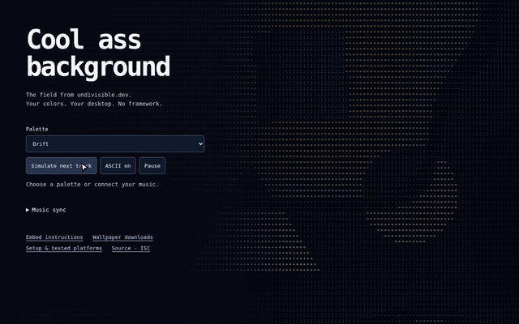

# Cool ass background

The noise-driven ASCII field from [undivisible.dev](https://undivisible.dev),
extracted into a framework-free WebGL shader and native wallpaper hosts.
ISC licensed. No telemetry, microphone capture, or bundled music.

**[Live demo](https://background.undivisible.dev)** ·
**[Wallpaper downloads](https://github.com/undivisible/cool-ass-background/releases)**

[](https://background.undivisible.dev/demo.mp4)

**[Watch the 28-second video](https://background.undivisible.dev/demo.mp4)** — actual
Chromium capture, with a moving pointer, simulated track-color crossfade,
ASCII/raw-field toggles and a reference-preset switch. No generated footage.

The demo supports Nord, Dracula, Taiga, Electric reference, Acid blue,
Cyan pink, Solar flare and Drift. Presets and track changes use the same
interruptible 1.8-second palette crossfade. The reference image is not included.

## Website embed

Download the web archive from Releases, unpack it into `/background/` on your
own site, and import the standalone ES module. No React, build tool, API key,
external font or runtime dependency is required. Serve over HTTP(S), not file://.

```html
<style>
  body { background: #070b13; }
  #background { position: fixed; inset: 0; width: 100%; height: 100%;
    pointer-events: none; z-index: 0; }
  main { position: relative; z-index: 1; }
</style>
<canvas id="background" aria-hidden="true"></canvas>
<main>Your accessible page content stays in the DOM.</main>
<script type="module">
  import { createBackground } from '/background/background.js';
  const bg = createBackground(document.querySelector('#background'), {
    colors: ['#091334', '#00dfff', '#ff168b', '#7effed', '#ffe6ff'],
    ascii: true, fadeMs: 1800, fps: 30,
  });
  // On theme or track change; repeated calls continue from the displayed color.
  // bg.setPalette(fiveHexColors);
  // bg.setAscii(false); bg.pause(); bg.resume();
  // bg.dispose(); // when the containing page/component unmounts
</script>
```

For a quick prototype you can import the same module from
`https://background.undivisible.dev/background.js` (CORS enabled). Self-host a
release for stable versioning. `presets.json` contains the named palettes.
Use a CSS fallback and catch initialization errors for devices without WebGL.
The renderer respects reduced motion at initialization, pauses when the page
is hidden, restores lost WebGL contexts, and caps frame rate and pixel density.
This is the decorative field, not the source site's weather, reveal or DOM-to-ASCII compositor.

### Music colors

```js
import { createTrackSync, syncLastFm, syncMediaElement } from '/background/background.js';
const sync = createTrackSync(bg, message => console.info(message));
// Optional Last.fm: the user's public API key, never a shared API secret.
const stop = syncLastFm(sync, { user: 'YOUR_USERNAME', apiKey: 'YOUR_PUBLIC_API_KEY' });
// stop(); sync.dispose();

// Or connect your own local HTML audio/video player, with artwork metadata:
const detach = syncMediaElement(sync, document.querySelector('audio'), () => ({
  id: currentTrack.id, title: currentTrack.title, artwork: currentTrack.artworkUrl,
}));
// On a track change with reused media source, call sync.update(track) explicitly.
// detach();
```

Last.fm polls every 30 seconds, only uses currently-playing tracks, and retains
the last palette on pause, missing artwork, network failure or API errors.
Get your API key from [Last.fm](https://www.last.fm/api/account/create).
Artwork servers must allow CORS for browser extraction. Native hosts pass
local cover bytes as data URLs. A website cannot inspect playback in other
tabs or arbitrary desktop apps; use the native hosts for system playback.
The demo's **Simulate next track** uses deterministic named palettes, not a
claim of a real connected player. There is no bundled key or hidden proxy.

## Wallpaper setup

Builds are preview distributions. Download from
[Releases](https://github.com/undivisible/cool-ass-background/releases).
See the verification table below before treating a binary as device-tested.

| Download | Setup |
|---|---|
| [macOS Apple Silicon](https://github.com/undivisible/cool-ass-background/releases/download/v0.1.0/cool-ass-background-macos-arm64.zip) | Unzip, open app, use ≋ menu |
| [macOS Intel](https://github.com/undivisible/cool-ass-background/releases/download/v0.1.0/cool-ass-background-macos-x86_64.zip) | Unzip, open app, use ≋ menu |
| [Windows x64](https://github.com/undivisible/cool-ass-background/releases/download/v0.1.0/cool-ass-background-windows-x64.zip) | Unzip whole archive, run executable |
| [Android preview APK](https://github.com/undivisible/cool-ass-background/releases/download/v0.1.0/cool-ass-background-android-debug.apk) | Install, configure, choose live wallpaper |
| [Website module + demo](https://github.com/undivisible/cool-ass-background/releases/download/v0.1.0/cool-ass-background-web.zip) | Unzip onto your own HTTPS site |

### macOS 13+

Unzip the matching arm64 or x86_64 archive and move **Cool Ass Background.app**
to Applications. Open it; the ≋ menu bar icon offers palettes, local
Spotify/Music sync, Last.fm and Quit. All displays get noninteractive windows
behind desktop icons, without activating the players. Local sync requires
Automation permission for the selected players. No private MediaRemote API.
These builds are ad-hoc signed, **not notarized**: macOS may require an explicit
System Settings → Privacy & Security → Open Anyway after you inspect the source.
If managed-device policy forbids unsigned apps, build/sign locally instead.
Add it to Login Items yourself if desired; the app does not install an agent.

### Windows 10 2004+ / Windows 11, x64

Unzip the complete archive and run `CoolAssBackground.exe`. Install the
[Microsoft WebView2 Evergreen Runtime](https://developer.microsoft.com/en-us/microsoft-edge/webview2/)
if prompted. The notification-area menu offers palettes, local media-session
sync and Last.fm. Local sync works only with players publishing Windows SMTC
metadata/artwork. The app uses an Explorer WorkerW surface behind icons,
not an always-on-bottom window that may sit behind the static wallpaper.
Quit from its tray menu. After an Explorer restart or monitor-layout change,
relaunch it. Binaries are unsigned and may trigger SmartScreen.

### Android 13+, OpenGL ES 2.0

Install `cool-ass-background-android-debug.apk` after explicitly allowing
installation from your download source. Open **Cool Ass Background**, choose
Preset / Last.fm / Local playback, save, then **Preview & set live wallpaper**.
Local sync needs explicitly granted notification access for active media
sessions; the app does not read notification text. Players must expose album
art. Disable that permission to revoke access. Last.fm keys are held only in
app-private preferences, with backup disabled. Rendering and polling stop
when the wallpaper is not visible. This preview APK uses a development key,
not a Play Store signing identity; upgrades from different builds may require
uninstalling the previous preview first. No Android emulator/device is claimed.

## Verification status

| Target | Status |
|---|---|
| Browser shader, palette transitions | Chromium rendered all 8 distinct presets; actual artwork decode and 24 intermediate fade levels checked; desktop recording inspected |
| macOS wallpaper | arm64 and Intel builds passed; desktop rendering behind Finder and native preset-menu selection exercised on the macOS satellite |
| Windows wallpaper | x64 self-contained build passed; real Explorer/SMTC session unverified |
| Android live wallpaper | APK build and Android lint passed; real device/GLES/session behavior unverified |
| Real Last.fm / local player integration | Requires opt-in user credentials/player session; not yet end-to-end tested |

## Development

```sh
bun test
bun run build
bun run dev
# With the demo open in agent-browser:
agent-browser --session shader --restore eval --stdin < scripts/browser-check.js
# Native builds:
sh apps/macos/build.sh
dotnet publish apps/windows/Background.csproj -c Release -r win-x64 --self-contained true
gradle -p apps/android assembleDebug lintDebug   # Gradle 8.11.1, JDK 17, Android SDK 35
```

`src/field.frag` and `src/presets.json` are shared by web and Android. Desktop
apps bundle the actual web renderer, with no production-site dependency.
The source noise is contrast-remapped so all five colors can appear; shape
motion is analytic rather than the site's random CPU physics. These deliberate
portability changes preserve the field's character, not pixel-identical output.
Cloudflare hosting uses an independent Worker + ASSETS binding and custom
domain, following Moonshine's deploy-cloudflare shape, not an SSH host or
changes to any sister site. Build then `bunx wrangler deploy` with the account
owning the undivisible.dev zone selected. Roll back with Wrangler's Worker
rollback command; keep the domain bound to this Worker.

## Provenance and license

See [LICENSE](LICENSE) (ISC) and [NOTICE.md](NOTICE.md). Drift was inspected
for wallpaper and media patterns, but its MPL-2.0 source is not copied or
relicensed. The reference preset was extracted using quantized color-frequency
buckets separated by hue/value, retaining navy, electric blue, lime, cyan
and pink rather than an average: `#203060 #2040c0 #a0f080 #80d0f0 #e06080`.
The separate Acid blue and Cyan pink presets deliberately push saturation
beyond the photo's sampled colors. No reference image or cover art is shipped.
